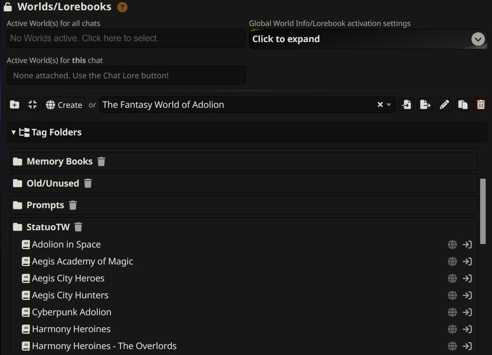
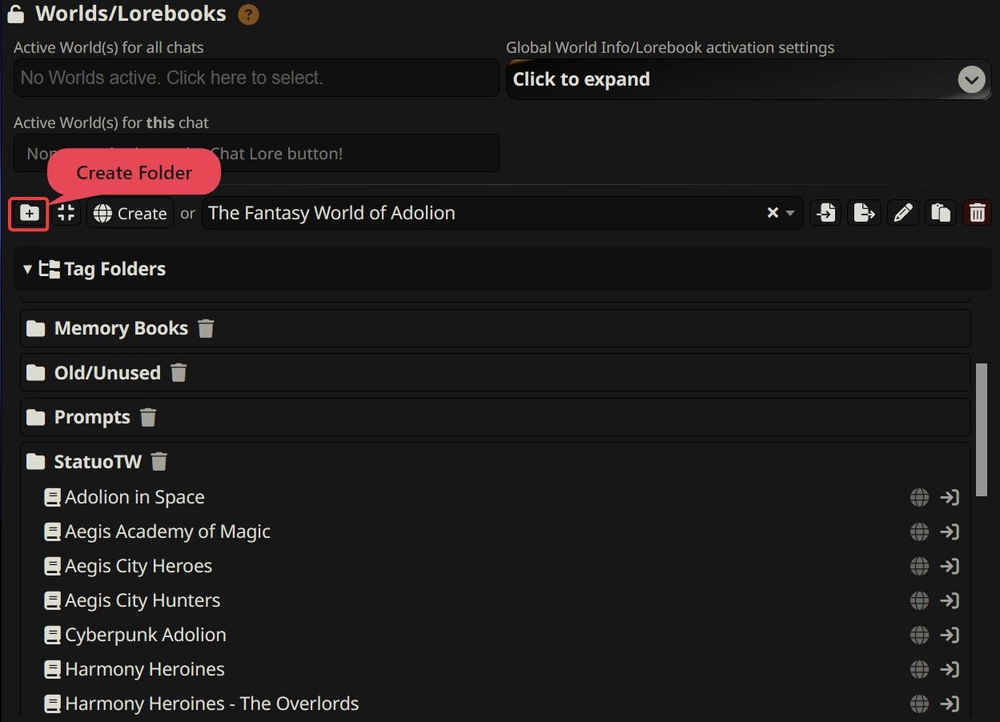
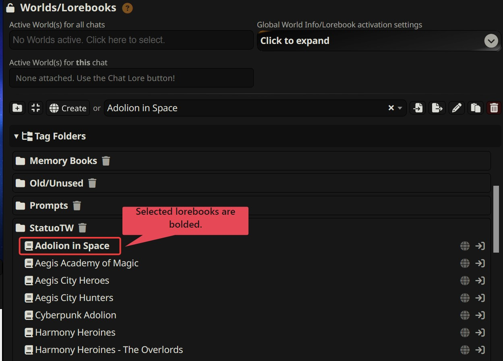
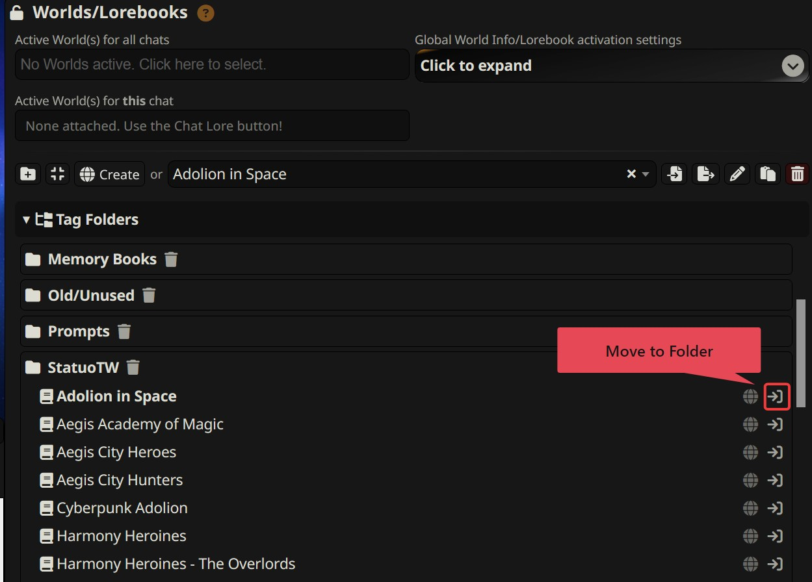
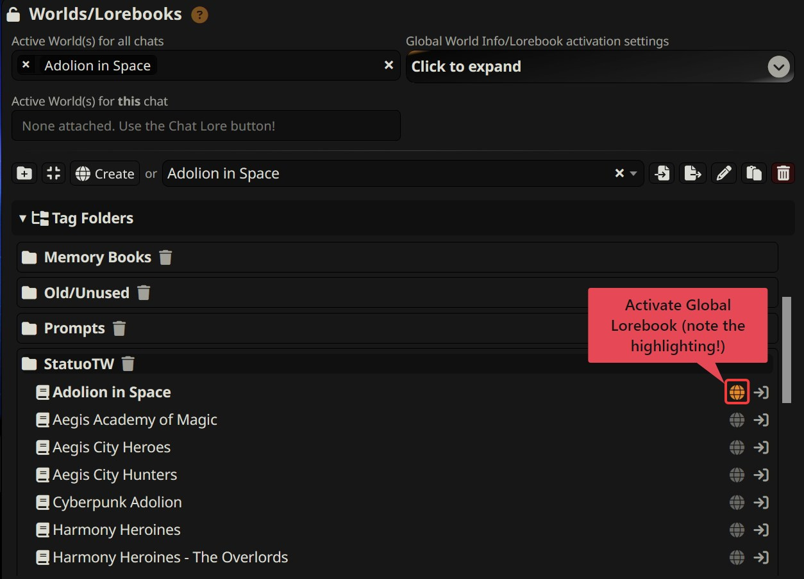
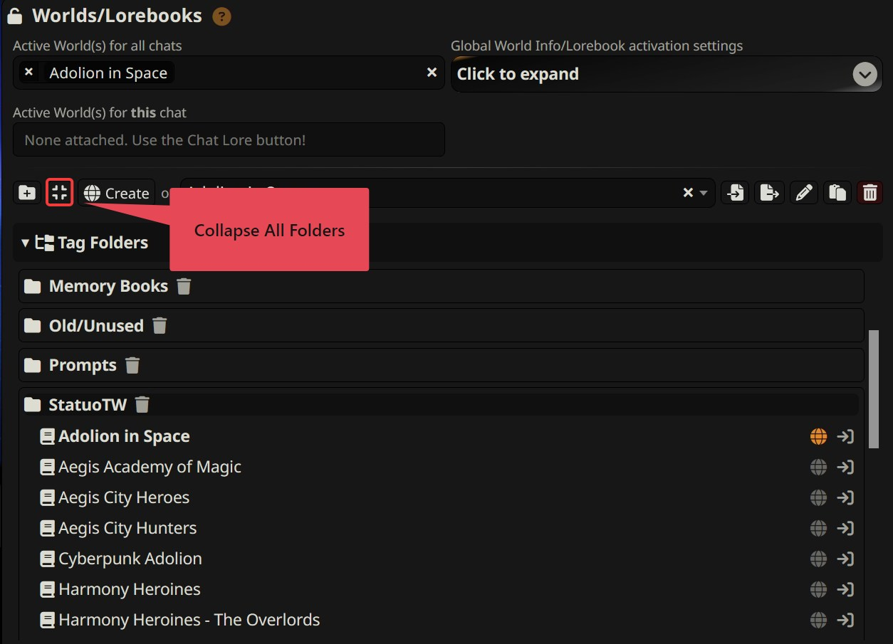
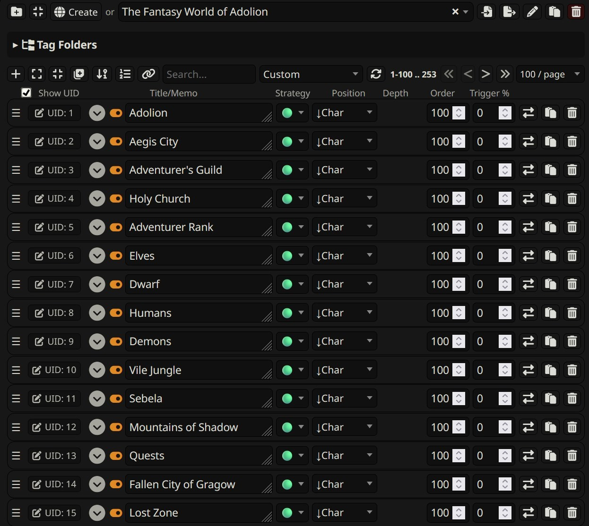
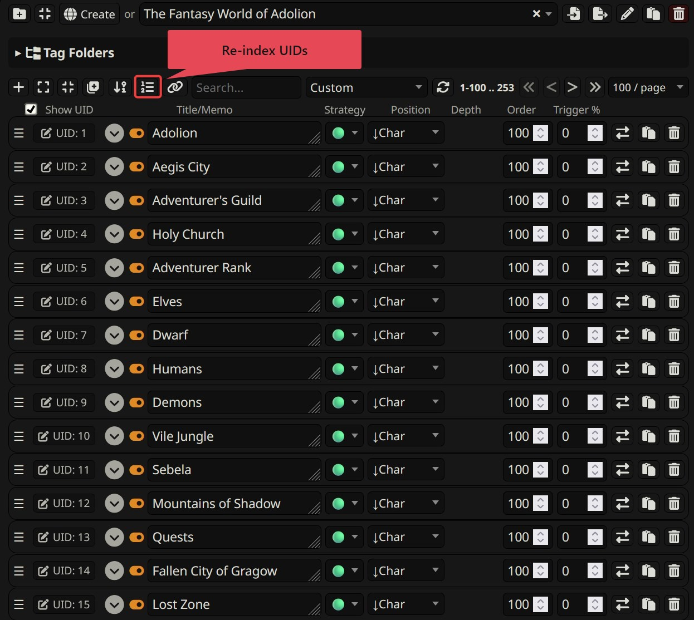
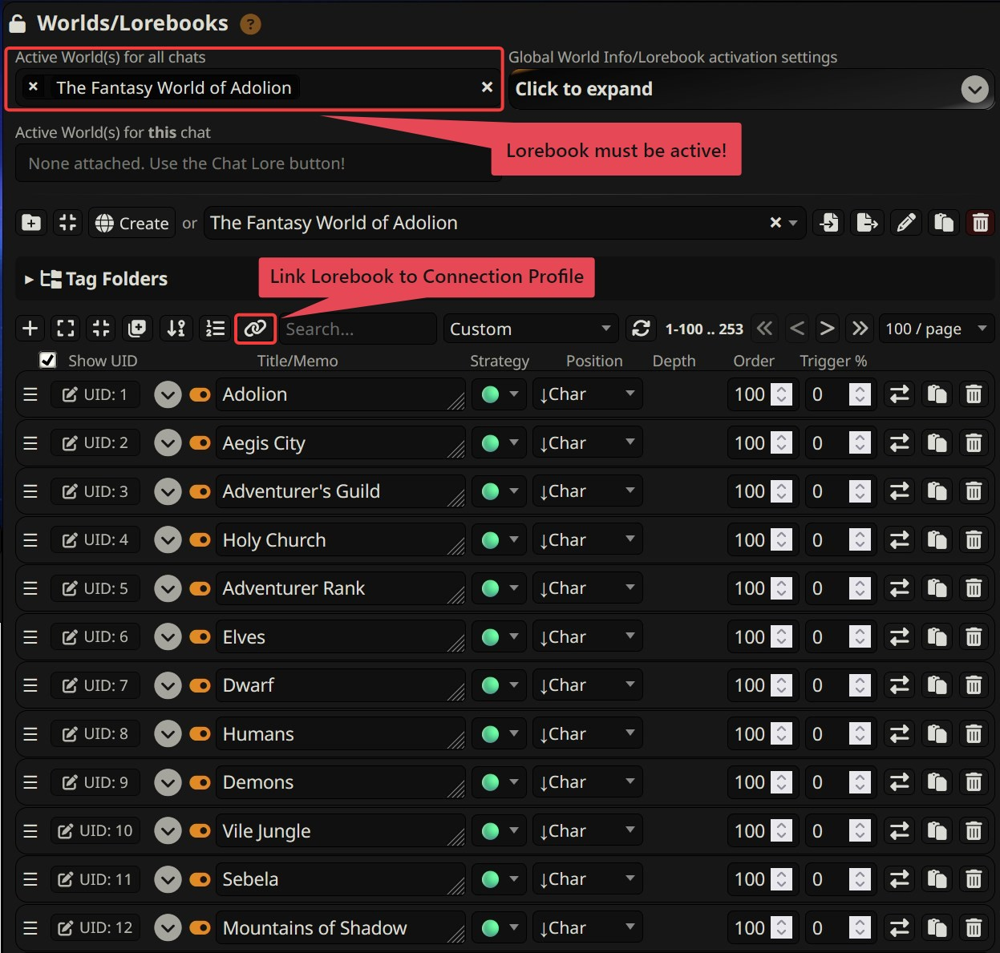
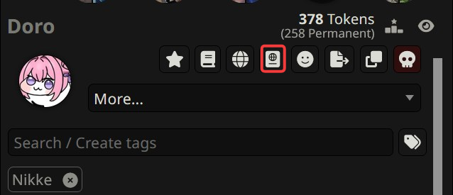

# WorldInfoPlus
**WorldInfoPlus** is an extension designed to add quality-of-life changes to SillyTavern's World Info feature. There are a number of pain points for lorebook creators and casual users alike - this extension aims to rectify some of them.
## Installation
1) Navigate to your SillyTavern extensions menu and click "Install extension".
2) Paste this URL into the URL field: `https://github.com/Phiarlan/SillyTavern-WorldInfoPlus/`
3) Click either of the install buttons.
## Features
### Lorebook Folders
SillyTavern's default lorebook search is a dropdown menu with **no interaction** beyond scrolling & selection for activating a lorebook (and for lorebook editing, you only get a search bar). This is fine in theory but quickly becomes unusable as a user acquires more and more lorebooks. **Lorebook Folders** adds the ability to categorize your lorebooks into organized folders, ensuring you can easily find the exact lorebook you're searching for.

New folders can be created by clicking the folder plus icon.

Lorebooks can be selected for editing by clicking on the name or book icon within the folder view.

Lorebooks can be placed in folders via either the dedicated button (the move icon) or via drag-and-drop!

You can even activate lorebooks directly by clicking the globe icon!

Folders can all be collapsed from view with the 'collapse all folders' button (located just to the left of the Create button).

Deleting a lorebook folder will move all lorebooks in the deleted folder back to the default "Uncategorized" folder.
### UID Editing
Have you ever exported a lorebook to an online frontend like CHub, Wyvern, or any other frontend that supports V2 character cards? You've probably noticed how your custom entry order gets scrambled and is instead sorted by **entry creation date** - that's because of the UID SillyTavern assigns to each entry! Ordinarily, editing it is a pain and requires manual JSON modification. Now you can edit it directly in SillyTavern!

Every entry now has its UID displayed to the left of the entry name before you even have to open the entry! These UID's can be edited directly or you can click the re-index UID's button (the numbered list icon next to the chain link icon) to automatically rename all UID's to be based on your custom view order!

And if you don't want to look at the UID's, no problem - there's a checkbox to disable the visuals!
### Connection Profile Integration
Some lorebooks, rather than acting as setting bibles, are instead prompt sets tailored for a specific model. It can sometimes be a challenge to remember to turn those lorebooks on or off when switching to a particular model provider.

But now you don't have to worry! You just have to click one button and your lorebook(s) will be synced to your chosen Connection Profile! Lorebooks must be **activated**, not open in the editor for them to be synced to Connection Profiles. If you have no lorebooks activated on a Connection Profile when you click the sync button, it will remove any lorebooks already connected to a Connection Profile.
### Improved Chat Lore Support
The Chat Lore feature (distinct from Character Lore) typically only allows **one** lorebook to be attached (whereas both Character Lore and global World Info allow multiple lorebooks). Now you can attach **multiple** lorebooks to one particular chat. Clicking the Chat Lore button will bring up a new menu that allows you to check the boxes for multiple lorebooks.

Once you save your selections, they will appear in the new "Active World(s) for **this** chat" field in the global World Info panel.
## License
This project is licensed under the **GNU Affero General Public License v3.0**.
See [LICENSE](LICENSE) for details.
## AI Disclaimer
LLM tools were used for assistance with creating this extension's code. The final code was human-reviewed and the extension itself has been tested by several people prior to its release.
## Support
If you want to support me and my work, consider donating to my Ko-fi! (https://ko-fi.com/sibdoesstuff)

If you need additional troubleshooting beyond GitHub issues, my Discord handle is `siberys`. **Generally speaking**, since I get a high volume of spambot friend requests, it is best to use one of the dedicated extension threads I have for issue reporting.
